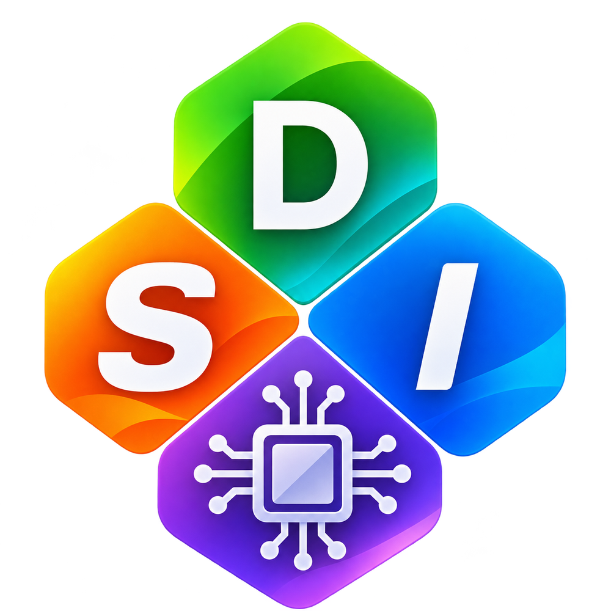
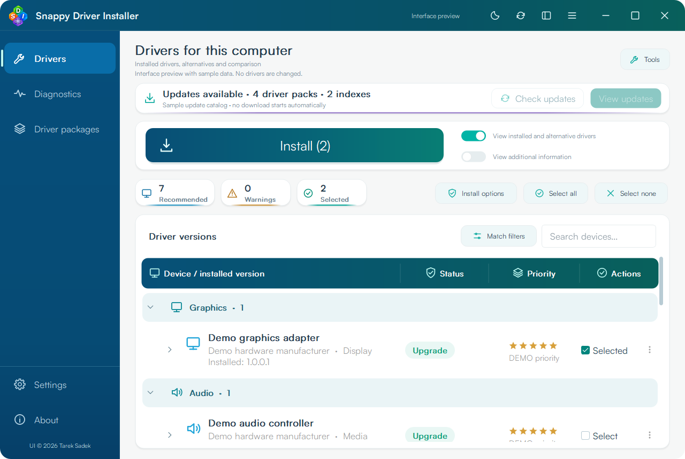
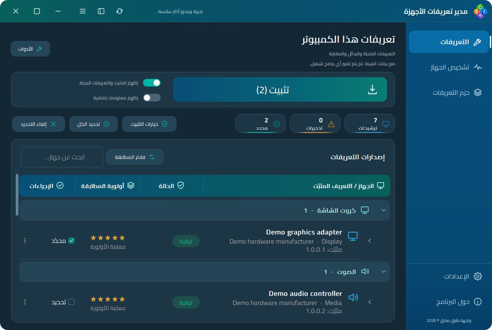
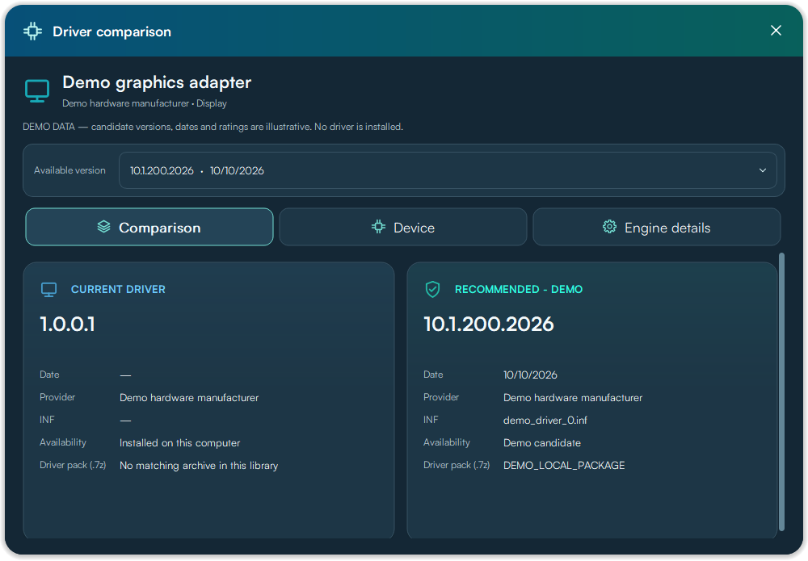
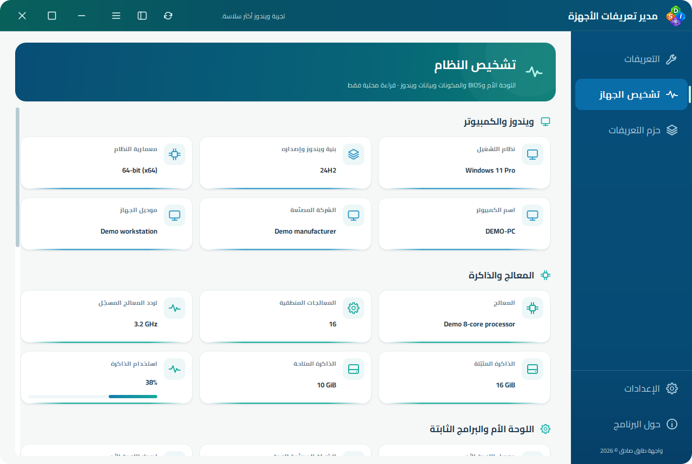

<div align="center">
  
  <h1>Snappy Driver Installer Modern</h1>
  <p><strong>Your driver library. The original matching engine. A modern Windows experience.</strong></p>
  <p>Scan, compare and manage drivers from one portable application.<br>Created by <strong>Tarek Sadek · Diagoo1</strong></p>
  <p>
    <a href="https://github.com/Diagoo1/Snappy-Driver-Installer-Modern/releases/tag/v0.23.9"></a>
    
    
  </p>
  <p><a href="README_AR.md">العربية</a> · <a href="#screenshots">Screenshots</a> · <a href="#get-started">Get started</a> · <a href="https://github.com/Diagoo1/Snappy-Driver-Installer-Modern/issues/new?template=bug_report.yml">Report a bug</a></p>
</div>

---

## Overview

**Snappy Driver Installer Modern** brings the driver workflow into a native, theme-aware Windows interface: organized device categories, clear version comparisons, explicit installation choices and readable results. It embeds a pinned **SDIO Origin** matching engine and works with local **SDI / SDIO library layouts**.

One executable contains the interface, fonts and engine. Your driver packs and indexes stay in separate folders, so an existing offline library can be reused without bundling gigabytes of drivers into the application.

> **Public Beta · 0.23.9** — This consolidated release contains the accumulated engine integration and interface improvements. Hardware and Windows compatibility testing is ongoing. This is an independent community project, with original engine and contributor credits preserved.

## Features at a glance

| | What you can do |
| --- | --- |
| 🖥️ **Driver workspace** | Scan devices, browse collapsible categories, search and compare installed/available versions. |
| 🎯 **Recommended view** | Start with eligible local engine recommendations; switch to all matches or custom filters when needed. Manual selections remain visible. |
| 🔎 **Version comparison** | Inspect version, date, provider, INF, device identifiers and the actual driver-pack archive. |
| 🛠️ **Installation workflow** | Review the plan and restore-point preference, follow each item's result and distinguish updates from reinstalls. |
| 📦 **Offline libraries** | Detect SDI/SDIO directory layouts, select local packs/indexes, extract packages and maintain the private index cache. |
| 🌐 **Package downloads** | See source-aware update notices; compare package versions and download/resume with live speed, ETA and verified progress. |
| 📊 **Diagnostics & tools** | Inspect system information, export reports and use supported maintenance/backup tools. |
| 🎨 **Personalization** | Light/dark themes, sliding sidebar hover/selection, theme import/export, independent interface scaling and embedded vector icons/fonts. |
| 🌍 **Languages** | Complete collected English/Arabic interface coverage with RTL; 40 embedded catalogs, with partial English fallback in other locales. |
| ⚙️ **Automation** | JSON plans and the implemented legacy command/script workflow. See the compatibility guide for scope. |

## Screenshots

<table>
<tr><th>English · Light</th><th>العربية · داكن</th></tr>
<tr><td><a href="docs/screenshots/en-light/01-drivers.png"></a></td><td><a href="docs/screenshots/ar-dark/01-drivers.png"></a></td></tr>
<tr><th>Driver comparison</th><th>Diagnostics</th></tr>
<tr><td><a href="docs/screenshots/en-dark/09-comparison.png"></a></td><td><a href="docs/screenshots/ar-light/03-diagnostics.png"></a></td></tr>
</table>

[**Explore the full gallery →**](docs/GALLERY.md) — English/Arabic, light/dark, settings, downloads, tools and installation screens. Captures use sample data; installation/completion images are labeled simulations, not records of a real installation.

## Explore the workspace

### Drivers — from scan to an explicit choice

- Browse graphics, chipset, audio, network and other device categories.
- Use **Recommended view** for a focused list, or turn it off in **Match filters** to inspect every available match.
- Expand a device to compare versions. Select the exact version you intend to install; select it again to clear it.
- Open the details dialog for comparison, hardware identity and engine metadata. Stars express relative matching priority, not a safety or quality score.
- Keep your place while making selections; selected versions and expanded categories survive list refreshes.

### Installation — review, progress and results

The installation page opens from the reviewed selection. It identifies reinstalls separately, displays the queue and reports each operation's outcome. A required restore point is requested before installation; if Windows cannot create it, installation stops with the actual reason.

**Reinstalling the same version:** expand the device and select its installed-version row when an eligible matching local package exists. Installed Windows metadata alone is not a driver archive. Add/download that version's package and rescan if it is missing.

### Driver-pack updates

A notice on the Drivers page opens the download center. Review new/local versions, packages for the last scan, filters, per-file progress, speed, ETA and peers. The optional startup check downloads metadata only. [Update-center guide](docs/UPDATE_CENTER.md).

### Library, diagnostics and settings

Manage pack/index locations, inspect downloads and sharing, export local reports and use the available maintenance tools. Compatibility preview stages another Windows/architecture target until **Apply**; **Restore default** returns to this computer and rescans. Installation is disabled while previewing another target.

Settings include language/RTL, theme, motion, interface size and the project's release channel. Preferences are stored in Windows Registry, with no adjacent INI file.

## Get started

1. Download the **EXE** or **portable ZIP** from [0.23.9 Beta](https://github.com/Diagoo1/Snappy-Driver-Installer-Modern/releases/tag/v0.23.9).
2. Place the application beside your library, or select its folders in Settings:

```text
Your driver library/
├── SnappyDriverInstaller-TS.exe
├── drivers/                 ← your existing .7z driver packs
└── indexes/
    └── SDI/ or SDIO/         ← library indexes, when available
```

3. Scan the computer and review the recommended matches. No driver packs are included in the application download.
4. Select the versions you need and review **Install options**. If elevation is required, reopen as Administrator, then scan and confirm again. Reopening never starts an installation automatically.

| Download | Contents |
| --- | --- |
| [Portable application](https://github.com/Diagoo1/Snappy-Driver-Installer-Modern/releases/download/v0.23.9/SnappyDriverInstaller-Modern-0.23.9-Beta-portable.zip) | One EXE with the license notices and quick-start text. No adjacent runtime DLLs. |
| [Standalone EXE](https://github.com/Diagoo1/Snappy-Driver-Installer-Modern/releases/download/v0.23.9/SnappyDriverInstaller-TS.exe) | The same application executable. |
| [Source code](https://github.com/Diagoo1/Snappy-Driver-Installer-Modern/releases/download/v0.23.9/SnappyDriverInstaller-Modern-0.23.9-source.zip) | The source snapshot for this release. |
| [Screenshots](https://github.com/Diagoo1/Snappy-Driver-Installer-Modern/releases/download/v0.23.9/SnappyDriverInstaller-Modern-0.23.9-screenshots.zip) | The English/Arabic light/dark gallery. |
| [SHA-256 checksums](https://github.com/Diagoo1/Snappy-Driver-Installer-Modern/releases/download/v0.23.9/SHA256SUMS.txt) | Integrity hashes for the published downloads. |

## Compatibility & Beta status

| Area | Current scope |
| --- | --- |
| **Matching engine** | Embedded, pinned SDIO Origin; external SDI/SDIO executables are not launched. |
| **SDI / SDIO libraries** | Auto-detected layouts. Compatible SDW 0x204/0x205 indexes are copied into a private cache; unsupported indexes can be regenerated from local archives. Source library indexes remain untouched. |
| **Windows / architecture** | Static x86 build targeting XP–11, with an embedded x64 installation helper. Older Windows and actual 32-bit hosts still need validation. No native ARM64 build. |
| **Hardware operations** | Real installs, restore creation, backup and reboot still need controlled hardware/VM testing. Read-only scans and fixture tests are recorded separately. |
| **Application updates** | Automatic updates follow stable releases. The current consolidated download is a Beta; use Browse releases until a stable version is published. |

Both library layouts were tested using the same supplied SDI R2600 pack library and returned equal device/candidate counts. This does not certify every fork's index format or universal Windows compatibility.

[Validation results](docs/VALIDATION.md) · [Engine provenance](docs/ARCHITECTURE.md) · [SDI/SDIO parity audit](docs/SOURCE_PARITY_AUDIT_AR.md) · [Restore behavior](docs/RESTORE_BEHAVIOR.md)

## Report a problem & contribute

[**Open a bug report →**](https://github.com/Diagoo1/Snappy-Driver-Installer-Modern/issues/new?template=bug_report.yml) Include your Windows version/architecture, application version, steps to reproduce and a screenshot when useful. Review logs before attaching them to a public issue. The in-app bug report shows a preview and opens GitHub; it does not send an issue automatically.

Hardware test results, reproducible bug reports, translation reviews and small focused pull requests are welcome. For scripts and command support, read the [legacy compatibility guide](docs/LEGACY_COMPATIBILITY_AR.md).

## Build from source

Use the single **`BUILD.cmd`** menu for setup, builds and checks:

```bat
BUILD.cmd -PrepareStaticQt
BUILD.cmd -SkipSourceDownload
BUILD.cmd -MatchingOnly
BUILD.cmd -RunTests
BUILD.cmd -Help
```

[Build instructions](docs/BUILDING.md) · [Changelog](CHANGELOG.md) · [License notices](docs/licenses)

Build outputs, private reports, caches and vendor checkouts are excluded from Git. Standalone Satoshi fonts are fetched and fingerprint-checked during bootstrap rather than redistributed in the source archive.

---

<div align="center">
  <h3>Made with ❤️ by Tarek Sadek</h3>
  <p>Interface design, integration & modifications, and application icon design · <a href="https://github.com/Diagoo1">Tarek Sadek (Diagoo1)</a><br>Creator of <a href="https://github.com/Diagoo1/Dreams-Software-Collection">Dreams Software Collection</a></p>
  <p><a href="https://ko-fi.com/diagoo1">☕ Support on Ko-fi</a> · <a href="https://paypal.me/Diagoo1">PayPal</a> · <a href="mailto:tarek.sadek44@gmail.com">Contact</a></p>
  <p>GPL-3.0 · Matching and installation are based on SDIO contributors' work.<br>Original SDI/SDIO authors, engine contributors and third-party component rights are preserved. <a href="LICENSE-GPL-3.0.txt">Read the license</a>.</p>
</div>

Choose Automatic / SDI / SDIO and Never or a manual, startup, hourly, launch-count or dated metadata check under **Settings → Driver library updates**. This also works without an existing library. The schedule runs while the application is open; overdue time-based checks run after reopening.

**Manual** hides the home update notice after reopening until you check again; **Never** hides it entirely. Settings → Check now opens the Download center and checks fresh metadata.

### Automatic appearance

The titlebar moon/sun button and Settings dark-mode switch stay synchronized. **Follow Windows theme automatically** is the default for profiles without an explicit theme mode: Windows 10/11 follow the current app theme, while older Windows uses light. Turning either manual control off/on saves a manual Light/Dark choice and clears automatic mode. Enable automatic mode in Settings to follow Windows again. Windows notifications and activation refresh the choice without polling.
