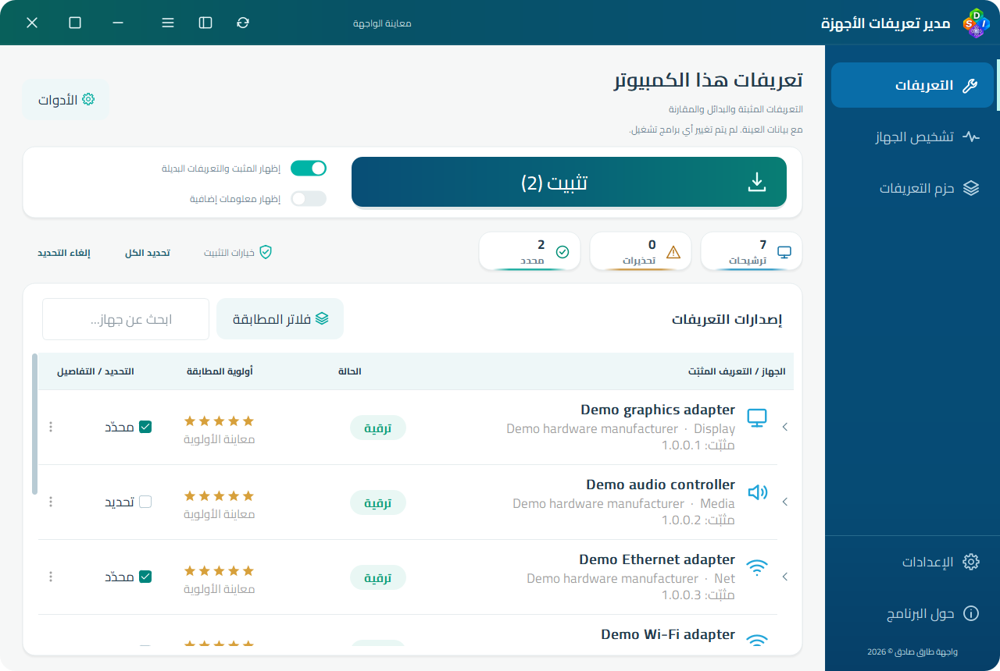
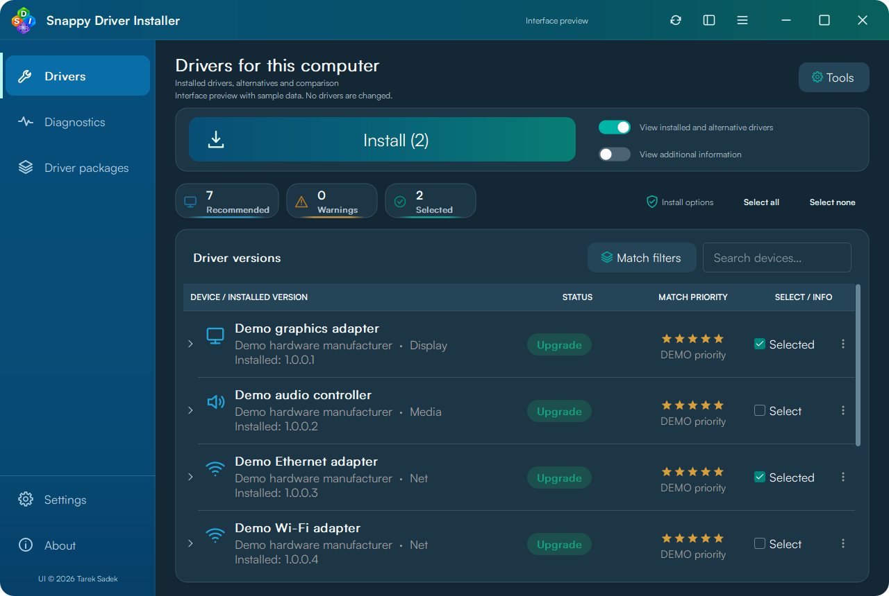

<div align="center" dir="rtl">
  
  <h1>مدير تعريفات الأجهزة — الواجهة الحديثة</h1>
  <p><strong>مطابقة المحرك الأصلي، وواجهة حديثة، وخطوات أوضح.</strong></p>
  <p>مشروع مجتمعي من تطوير <strong>طارق صادق · Diagoo1</strong></p>
  <p> </p>
  <p><a href="README.md">English</a> · <a href="https://github.com/Diagoo1/Snappy-Driver-Installer-Modern/releases/tag/v0.21.7">تحميل البيتا</a> · <a href="docs/GALLERY.md">معرض الصور</a> · <a href="https://github.com/Diagoo1/Snappy-Driver-Installer-Modern/issues/new?template=bug_report.yml">الإبلاغ عن مشكلة</a></p>
</div>

## فكرة المشروع

واجهة Windows حديثة تدمج محرك **Snappy Driver Installer Origin** لفحص الأجهزة ومطابقة التعريفات، مع عرض الإصدارات البديلة ومقارنتها ومتابعة التثبيت من صفحة مستقلة. البرنامج **ملف EXE واحد**، وتبقى حزم التعريفات والفهارس في مجلدات منفصلة.

**هذه نسخة بيتا.** نحتاج تجارب على أجهزة وإصدارات ويندوز مختلفة. التثبيت الفعلي ونقاط الاستعادة وإعادة التشغيل تحتاج اختبارات إضافية على أجهزة تجارب. هذا مشروع مستقل، وليس إصدارًا رسميًا من فريق SDI أو SDIO.

## جولة بالصور

| العربية · فاتح | العربية · داكن |
| --- | --- |
| [](docs/screenshots/ar-light/01-drivers.png) | [](docs/screenshots/ar-dark/01-drivers.png) |
| English · Light | English · Dark |
| [](docs/screenshots/en-light/01-drivers.png) | [](docs/screenshots/en-dark/01-drivers.png) |

[شاهد المعرض الكامل](docs/GALLERY.md). الصور ببيانات توضيحية؛ صور التثبيت محاكاة معلنة، وليست إثباتًا لتثبيت فعلي.

## أدوات لكل مرحلة

| القسم | ما الذي يقدمه؟ |
| --- | --- |
| التعريفات | فحص الأجهزة، عرض المثبّت والبدائل، مقارنة البيانات واختيار إصدار محدد |
| التثبيت | مراجعة التحديد وخيارات الاستعادة وإعادة التشغيل، وطلب إعادة الفتح كمسؤول عند الحاجة، وعرض نتيجة كل تعريف |
| المكتبة | اختيار مجلدات الحزم والفهارس، التنزيل والاستئناف، الاستخراج وصيانة الفهارس |
| الجهاز | التشخيص، حفظ اللقطات واستعراضها، والوصول إلى أدوات ويندوز |
| المظهر | العربية RTL بخط Cairo والإنجليزية بخط Satoshi، فاتح وداكن، تكبير وثيمات JSON |
| الأتمتة | الأوامر والسكربتات القديمة وخطط تثبيت JSON يتم التحقق منها |
| البلاغات | معاينة بيانات البيئة الأساسية قبل فتح بلاغ GitHub علني، دون إرسال أو رفع سجلات تلقائيًا |

النجوم تعبّر عن **أولوية المطابقة النسبية**، وليست تقييم أمان. توجد 40 لغة مدمجة؛ العربية والإنجليزية تغطيان المفاتيح الحالية، وبعض النصوص الجديدة تظهر بالإنجليزية في اللغات الأخرى. نرحّب بمراجعة الترجمات.

## البدء

1. حمّل الملف التنفيذي أو الحزمة المحمولة من [الإصدار 0.21.7 Beta](https://github.com/Diagoo1/Snappy-Driver-Installer-Modern/releases/tag/v0.21.7).
2. ضع `drivers` و`indexes` بجواره، أو اختر مساراتهما من الإعدادات. الحزم غير مرفقة.
3. افحص الجهاز وراجع الإصدارات والتحديد. إذا احتاج البرنامج صلاحيات المسؤول، يعرض إعادة الفتح؛ أعد الفحص والتأكيد بعدها. لا يبدأ تثبيت تلقائي عند إعادة الفتح.

الإعدادات في Registry للمستخدم، دون DLL أو INI بجوار البرنامج. التحديث التلقائي للبرنامج يتابع القناة المستقرة؛ تنزيل البيتا من رابط إصدارها المباشر.

## التوافق مع SDI وSDIO وويندوز

يكتشف البرنامج مكتبات **SDI وSDIO تلقائيًا**، سواء كانت الفهارس مباشرة أو داخل `indexes/SDI` أو `indexes/SDIO`. عند وجود النوعين يختار وفق ملفات التوزيعة أو أسماء الفهارس المطابقة للحزم المحلية. الفحص وصيانة الفهارس يعملان في كاش خاص بالبرنامج: تُنسخ الفهارس المتوافقة بصيغتي SDW 0x204 و0x205، وتُعاد الفهارس غير المتوافقة من الحزم المحلية المتاحة، دون الكتابة فوق فهارس المكتبة الأصلية أثناء المعالجة.

اختُبر الترتيبان باستخدام مكتبة حزم SDI R2600 نفسها، وأعطيا أعداد الأجهزة والمرشحين نفسها، مع اختبار إعادة بناء فهرس غير متوافق. يظل محرك المطابقة SDIO Origin مدمجًا؛ لا يحتاج البرنامج تشغيل ملفات SDI أو SDIO الخارجية، ولا ندّعي دعم أي صيغة مجهولة لدى كل الفروع.

بناء x86 يستهدف XP حتى 11 ويتضمن مساعد عمليات تعريفات x64. التشغيل على ويندوز القديم وأنظمة 32 بت والتوافق مع جميع الأجهزة ما زال يحتاج تحققًا فعليًا. هذه ليست نسخة ARM64 أصلية. راجع [حدود الاختبار](docs/VALIDATION.md) و[مصدر المحرك](docs/ARCHITECTURE.md).

## البناء والمساهمة

ملف الأوامر الوحيد هو **`BUILD.cmd`**؛ افتحه لقائمة الخيارات أو استخدم:

```bat
BUILD.cmd -PrepareStaticQt
BUILD.cmd -SkipSourceDownload
BUILD.cmd -MatchingOnly
BUILD.cmd -RunTests
BUILD.cmd -Help
```

[دليل البناء](docs/BUILDING.md) · [مقارنة وظائف المحرك](docs/SOURCE_PARITY_AUDIT_AR.md) · [السكربتات والأوامر](docs/LEGACY_COMPATIBILITY_AR.md) · [سجل التغييرات](CHANGELOG.md)

| المجلد | محتواه |
| --- | --- |
| `src` و`native` | الواجهة وربط المحرك |
| `assets` و`i18n` و`themes` | الموارد والترجمات ونموذج الثيم |
| `tools` | أدوات البناء والتحقق والنشر |
| `tests` | اختبارات تمنع رجوع الأخطاء؛ لا تُوزّع مع ملف التشغيل |
| `docs` | الشرح والاختبارات والصور والتراخيص |

الكاش ومخرجات البناء وتقارير الأجهزة الخاصة والمكتبات المؤقتة غير مرفوعة إلى Git. تُنزّل ملفات Satoshi المستقلة من مصدرها مع التحقق منها أثناء تجهيز البناء، ولا تُوزّع في السورس.

## الحقوق

GPL-3.0 مع حفظ حقوق مطوّري SDIO والمكتبات المستخدمة. راجع [الترخيص](LICENSE-GPL-3.0.txt) و[إشعارات المكونات](docs/licenses). مطابقة التعريفات وتثبيتها مبنية على عمل مساهمي SDIO؛ الواجهة الحديثة من تطوير طارق صادق.

<div align="center" dir="rtl">صُنع بعناية بواسطة <strong>طارق صادق · Diagoo1</strong><br><a href="https://github.com/Diagoo1">مشاريعي</a> · <a href="https://github.com/Diagoo1/Dreams-Software-Collection">مجموعة دريمز للبرامج</a></div>
