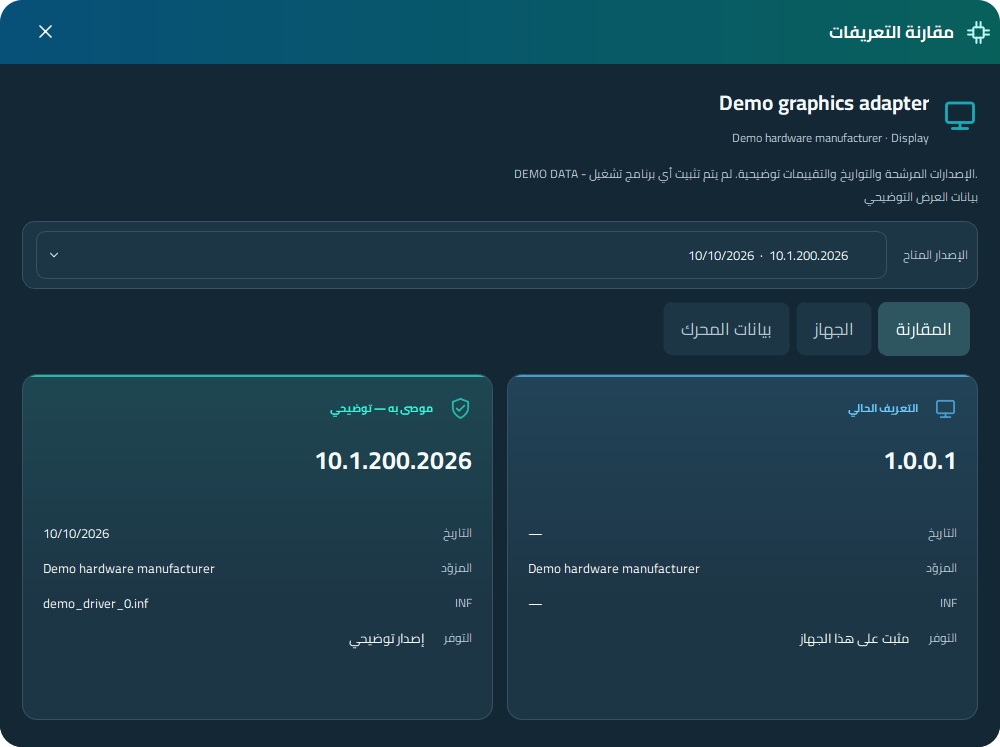

<div align="center" dir="rtl">
  
  <h1>مدير تعريفات الأجهزة — الواجهة الحديثة</h1>
  <p><strong>مكتبة تعريفاتك، ومحرك المطابقة الأصلي، وتجربة Windows حديثة.</strong></p>
  <p>فحص ومقارنة وإدارة التعريفات من برنامج محمول واحد.<br>من تطوير <strong>طارق صادق · Diagoo1</strong></p>
  <p><a href="https://github.com/Diagoo1/Snappy-Driver-Installer-Modern/releases/tag/v0.23.2"></a> </p>
  <p><a href="README.md">English</a> · <a href="#جولة-بالصور">الصور</a> · <a href="#ابدأ-الاستخدام">ابدأ الاستخدام</a> · <a href="https://github.com/Diagoo1/Snappy-Driver-Installer-Modern/issues/new?template=bug_report.yml">الإبلاغ عن مشكلة</a></p>
</div>

---

## فكرة المشروع

**Snappy Driver Installer Modern** يعيد تقديم تجربة إدارة تعريفات Windows بواجهة أصلية حديثة: تصنيفات واضحة للأجهزة، ومقارنة الإصدارات، واختيار صريح لما سيتم تثبيته، ونتائج سهلة القراءة. يدمج محرك **SDIO Origin** بإصدار محدد، ويتعرّف على تنظيم مكتبات **SDI وSDIO** المحلية.

الواجهة والخطوط والمحرك داخل ملف تنفيذي واحد. تظل الحزم والفهارس في مجلدات منفصلة، فتستخدم مكتبتك الأوفلاين الموجودة دون تضخيم البرنامج بحزم التعريفات.

> **بيتا عامة · 0.23.2** — إصدار موحّد يجمع تعديلات الواجهة وربط المحرك المتراكمة. اختبار الأجهزة وإصدارات Windows مستمر. هذا مشروع مجتمعي مستقل، مع حفظ حقوق المحرك الأصلي ومساهميه.

## المزايا بنظرة واحدة

| | ما الذي يقدّمه؟ |
| --- | --- |
| 🖥️ **مساحة التعريفات** | فحص الأجهزة، وتصنيفات قابلة للفتح والغلق، وبحث ومقارنة بين المثبّت والبدائل. |
| 🎯 **العرض الموصى به** | قائمة مختصرة بالترشيحات المؤهلة المتوفرة محليًا، مع عرض الكل أو تخصيص الفلاتر عند الحاجة. اختياراتك اليدوية تظل ظاهرة. |
| 🔎 **تفاصيل الإصدار** | الإصدار والتاريخ والمورّد وملف INF ومعرّفات الجهاز واسم حزمة التعريف الفعلية. |
| 🛠️ **خطوات التثبيت** | مراجعة الخطة ونقطة الاستعادة، ومتابعة نتيجة كل عنصر، وتمييز الترقية عن إعادة التثبيت. |
| 📦 **مكتبات أوفلاين** | اكتشاف مجلدات SDI/SDIO، واختيار الحزم والفهارس، والاستخراج وصيانة نسخة الفهارس الخاصة بالبرنامج. |
| 🌐 **تنزيل الحزم** | إشعار بتحديثات مصدر المكتبة، ومقارنة الإصدارات، وتنزيل واستئناف مع السرعة والوقت المتبقي والتقدم المتحقق. |
| 📊 **التشخيص والأدوات** | معلومات النظام، وتصدير التقارير، وأدوات الصيانة والنسخ الاحتياطي المتاحة للنظام. |
| 🎨 **التخصيص** | فاتح وداكن، وانتقال سلس للهوفر والتحديد بالقائمة الجانبية، واستيراد وتصدير الثيم، وتكبير مستقل، وخطوط وأيقونات مدمجة. |
| 🌍 **اللغات** | تغطية كاملة للنصوص المجمّعة بالإنجليزي والعربي مع RTL؛ و40 كتالوجًا مدمجًا، مع رجوع جزئي للإنجليزي في اللغات الأخرى. |
| ⚙️ **الأتمتة** | خطط JSON ومسار الأوامر والسكربتات القديمة المنفّذ؛ التفاصيل في دليل التوافق. |

## جولة بالصور

<table>
<tr><th>العربية · فاتح</th><th>English · Dark</th></tr>
<tr><td><a href="docs/screenshots/ar-light/01-drivers.png"></a></td><td><a href="docs/screenshots/en-dark/01-drivers.png"></a></td></tr>
<tr><th>مقارنة التعريفات</th><th>تشخيص الجهاز</th></tr>
<tr><td><a href="docs/screenshots/ar-dark/09-comparison.png"></a></td><td><a href="docs/screenshots/ar-light/03-diagnostics.png"></a></td></tr>
</table>

[**افتح معرض الصور الكامل ←**](docs/GALLERY.md) — العربي والإنجليزي، فاتح وداكن، والإعدادات والتنزيل والأدوات وشاشات التثبيت. الصور ببيانات توضيحية؛ صور التثبيت والنتائج محاكاة معلنة، وليست تسجيلًا لتثبيت فعلي.

## تعرّف على صفحات البرنامج

### التعريفات — من الفحص إلى اختيار واضح

- تصفّح كارت الشاشة والشيبست والصوت والشبكة وباقي تصنيفات الأجهزة.
- استخدم «العرض الموصى به» لقائمة مختصرة، أو أوقفه من «فلاتر المطابقة» لتصفّح كل المطابقات.
- افتح إصدارات الجهاز، ثم حدّد الإصدار المطلوب. الضغط عليه مرة أخرى يلغي تحديده.
- افتح التفاصيل للمقارنة ومعرّفات الجهاز وبيانات المحرك. النجوم لأولوية المطابقة النسبية، وليست تقييم أمان أو جودة.
- حافظ على موضعك أثناء التحديد؛ تُحفظ حالة التصنيفات المفتوحة والاختيارات عند إعادة بناء القائمة.

### التثبيت — مراجعة ومتابعة ونتيجة

تُفتح صفحة التثبيت بعد مراجعة الاختيارات. تميّز إعادة التثبيت، وتعرض الطابور ونتيجة كل عملية. إذا كانت نقطة الاستعادة مطلوبة، تُطلب قبل التثبيت؛ وفشل Windows في إنشائها يوقف العملية مع توضيح السبب الحقيقي.

**إعادة تثبيت نفس الإصدار:** افتح إصدارات الجهاز وحدّد صف الإصدار المثبّت عندما تتوفر حزمته المحلية المطابقة والمؤهلة. بيانات التعريف المثبّت في ويندوز وحدها ليست حزمة تثبيت؛ أضف أو نزّل حزمة ذلك الإصدار ثم أعد الفحص إذا كانت غير موجودة.

### المكتبة والتشخيص والإعدادات

حدّد أماكن الحزم والفهارس، وتابع التنزيل والمشاركة، وصدّر التقارير المحلية واستخدم أدوات الصيانة المتاحة. معاينة التوافق تُجهّز هدف ويندوز أو معمارية أخرى حتى تضغط «تطبيق»؛ و«استعادة الافتراضي» ترجع لهذا الجهاز وتعيد الفحص. التثبيت معطّل أثناء معاينة هدف آخر.

الإعدادات تضم اللغة وRTL والثيم والحركة وحجم الواجهة وقناة إصدارات المشروع. تُحفظ التفضيلات في سجل Windows دون ملف INI بجوار البرنامج.

## ابدأ الاستخدام

1. حمّل **ملف EXE** أو **الحزمة المحمولة ZIP** من [0.23.2 Beta](https://github.com/Diagoo1/Snappy-Driver-Installer-Modern/releases/tag/v0.23.2).
2. ضع البرنامج بجوار المكتبة أو حدّد مجلداتها من الإعدادات:

```text
Your driver library/
├── SnappyDriverInstaller-TS.exe
├── drivers/                 ← ملفات حزم التعريفات .7z
└── indexes/
    └── SDI/ or SDIO/         ← الفهارس، إن وُجدت
```

3. افحص الجهاز وراجع الترشيحات. تنزيل البرنامج لا يتضمن حزم تعريفات.
4. حدّد الإصدارات وراجع «خيارات التثبيت». عند طلب صلاحيات المسؤول، أعد الفتح كمسؤول ثم افحص وأكّد من جديد؛ إعادة الفتح لا تبدأ التثبيت تلقائيًا.

| التنزيل | المحتوى |
| --- | --- |
| [الحزمة المحمولة](https://github.com/Diagoo1/Snappy-Driver-Installer-Modern/releases/download/v0.23.2/SnappyDriverInstaller-Modern-0.23.2-Beta-portable.zip) | ملف تشغيل واحد مع التراخيص ودليل بدء مختصر، دون DLL تشغيل بجواره. |
| [ملف EXE](https://github.com/Diagoo1/Snappy-Driver-Installer-Modern/releases/download/v0.23.2/SnappyDriverInstaller-TS.exe) | نفس ملف البرنامج التنفيذي. |
| [السورس](https://github.com/Diagoo1/Snappy-Driver-Installer-Modern/releases/download/v0.23.2/SnappyDriverInstaller-Modern-0.23.2-source.zip) | نسخة المصدر المطابقة للإصدار. |
| [الصور](https://github.com/Diagoo1/Snappy-Driver-Installer-Modern/releases/download/v0.23.2/SnappyDriverInstaller-Modern-0.23.2-screenshots.zip) | معرض العربي والإنجليزي بالوضعين. |
| [بصمات SHA-256](https://github.com/Diagoo1/Snappy-Driver-Installer-Modern/releases/download/v0.23.2/SHA256SUMS.txt) | للتحقق من سلامة التنزيلات المنشورة. |

## التوافق وحالة البيتا

| الجزء | النطاق الحالي |
| --- | --- |
| **محرك المطابقة** | SDIO Origin مدمج بإصدار محدد؛ لا يشغّل ملفات SDI/SDIO التنفيذية الخارجية. |
| **مكتبات SDI وSDIO** | اكتشاف تلقائي لتنظيم المجلدات. الفهارس المتوافقة SDW 0x204/0x205 تُنسخ لكاش خاص، وغير المدعومة يمكن توليدها من الحزم المحلية. الفحص لا يعدّل فهارس المكتبة الأصلية؛ تنزيل الفهارس المحددة يحدّث مجلد الوجهة صراحةً. |
| **Windows والمعمارية** | بناء x86 ثابت يستهدف XP إلى 11 مع مساعد تثبيت x64 مدمج. تشغيل ويندوز القديم وأنظمة 32 بت الفعلية يحتاج اختبارًا إضافيًا. لا توجد نسخة ARM64 أصلية. |
| **عمليات الجهاز** | التثبيت الفعلي وإنشاء نقاط الاستعادة والنسخ الاحتياطي وإعادة التشغيل تحتاج بيئة تجارب. نتائج الفحص للقراءة واختبارات المحاكاة موضّحة منفصلة. |
| **تحديث البرنامج** | التحديث التلقائي يتابع الإصدارات المستقرة. الإصدار الموحّد الحالي بيتا؛ استخدم تصفّح الإصدارات حتى نشر إصدار مستقر. |

اختُبر تنظيم المكتبتين بنفس حزم SDI R2600 المتاحة، وأنتجا نفس عدد الأجهزة والبدائل. هذا لا يثبت تطابق كل فروع الفهارس أو التوافق مع كل أنظمة ويندوز.

[نتائج التحقق](docs/VALIDATION.md) · [مصدر المحرك](docs/ARCHITECTURE.md) · [مقارنة الربط بالأصل](docs/SOURCE_PARITY_AUDIT_AR.md) · [سلوك نقطة الاستعادة](docs/RESTORE_BEHAVIOR.md)

## الإبلاغ والمساهمة

[**افتح بلاغ مشكلة ←**](https://github.com/Diagoo1/Snappy-Driver-Installer-Modern/issues/new?template=bug_report.yml) اذكر نسخة Windows والمعمارية وإصدار البرنامج وخطوات تكرار المشكلة وصورة مفيدة. راجع السجلات قبل نشرها في بلاغ عام. زر الإبلاغ داخل البرنامج يعرض معاينة ويفتح GitHub؛ ولا يرسل البلاغ تلقائيًا.

نتائج تجربة الأجهزة، والبلاغات القابلة للتكرار، ومراجعة الترجمة والمساهمات المحددة مرحّب بها. راجع [دليل الأوامر والسكربتات القديمة](docs/LEGACY_COMPATIBILITY_AR.md) لمعرفة النطاق المنفّذ.

## البناء من المصدر

استخدم قائمة **`BUILD.cmd`** الوحيدة لتجهيز البيئة والبناء والفحص:

```bat
BUILD.cmd -PrepareStaticQt
BUILD.cmd -SkipSourceDownload
BUILD.cmd -MatchingOnly
BUILD.cmd -RunTests
BUILD.cmd -Help
```

[دليل البناء](docs/BUILDING.md) · [سجل التغييرات](CHANGELOG.md) · [تراخيص المكونات](docs/licenses)

ملفات البناء والكاش والتقارير الخاصة والمكتبات المسحوبة غير مرفوعة إلى Git. تُنزّل ملفات Satoshi المستقلة مع التحقق من بصمتها أثناء تجهيز البناء، ولا تُوزّع منفصلة في أرشيف السورس.

---

<div align="center" dir="rtl">
  <h3>صُنع بكل ❤️ بواسطة طارق صادق</h3>
  <p>تصميم وتطوير الواجهة · <a href="https://github.com/Diagoo1">Diagoo1</a><br>مطوّر <a href="https://github.com/Diagoo1/Dreams-Software-Collection">مجموعة دريمز للبرامج</a></p>
  <p><a href="https://ko-fi.com/diagoo1">☕ ادعم المشروع بقهوة</a> · <a href="https://paypal.me/Diagoo1">PayPal</a> · <a href="mailto:tarek.sadek44@gmail.com">تواصل معي</a></p>
  <p>GPL-3.0 · المطابقة والتثبيت مبنيان على عمل مساهمي SDIO.<br>جميع حقوق المحرك والمكونات الأصلية محفوظة. <a href="LICENSE-GPL-3.0.txt">الترخيص</a>.</p>
</div>

### تحديث الحزم والفهارس

إشعار صفحة التعريفات يفتح مركز التنزيل: الإصدار الجديد والمحلي، والحزم المرتبطة بآخر فحص، والفلاتر، وتقدم كل ملف والسرعة والوقت المتبقي والمصادر. فحص البداية اختياري ويجلب بيانات الكتالوج فقط؛ التنزيل لا يبدأ التثبيت. [دليل مركز التنزيل](docs/UPDATE_CENTER.md).

من **الإعدادات ← تحديثات مكتبة التعريفات** اختَر تلقائي / SDI / SDIO، وحدد الفحص يدويًا أو عند التشغيل أو كل عدد ساعات أو مرات تشغيل أو في تاريخ ووقت محددين. الاختيار يعمل بدون مكتبة سابقة. الجدولة تعمل أثناء فتح البرنامج، وتلحق المواعيد الزمنية الفائتة عند إعادة فتحه.

**يدوي** يخفي شريط التحديث عند إعادة الفتح حتى تفحص مجددًا، و**عدم إظهار إشعارات التحديث مطلقًا** يخفيه بالكامل. زر «افحص الآن» في الإعدادات يفتح مركز التنزيل ويفحص بيانات جديدة.
